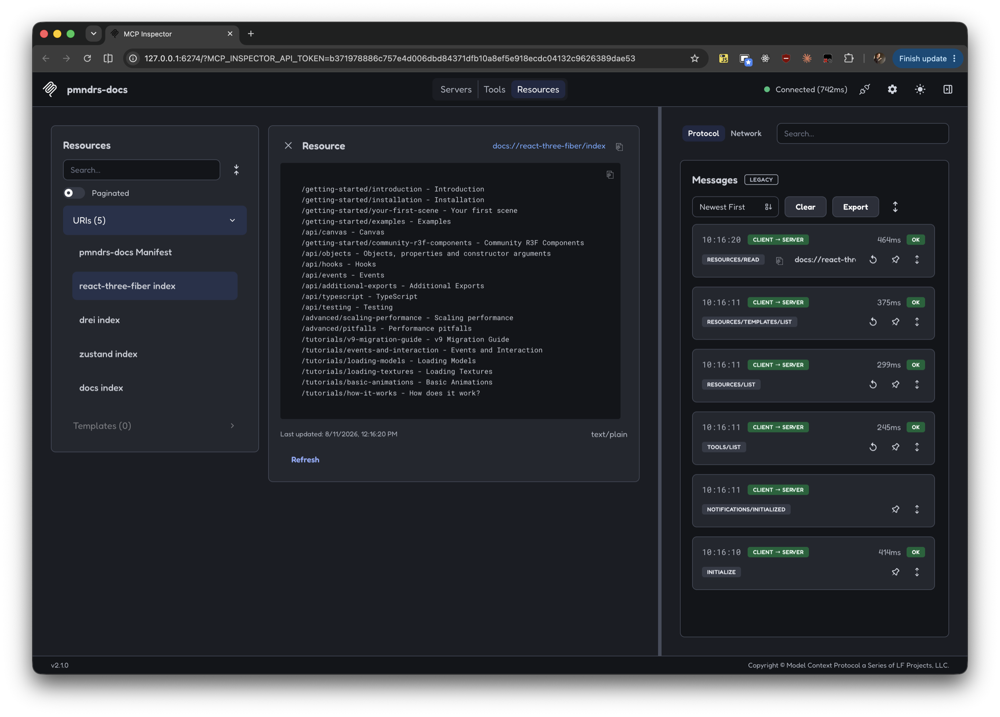

<Intro>
  Every site built with this generator publishes machine-readable dumps of its content, and [docs.pmnd.rs](https://docs.pmnd.rs) serves them to agents over MCP.
</Intro>

## llms.txt

Each site publishes [llms.txt](/llms.txt) and [llms-full.txt](/llms-full.txt), linked in the HTML head:

```html
<link rel="alternate" type="text/plain" href="/llms.txt" />
<link rel="alternate" type="text/plain" href="/llms-full.txt" />
```

## MCP server

<McpLiveEmbed />

`llms-full.txt` is too big to paste into an agent. The [MCP](https://modelcontextprotocol.io) server lets an agent read an index first, then fetch only the page it needs.

One endpoint for all libraries, over streamable HTTP: `https://docs.pmnd.rs/api/mcp`.

| kind     | name                     | gives                                                     |
| -------- | ------------------------ | --------------------------------------------------------- |
| resource | `docs://pmndrs/manifest` | the libraries served, and how to query them               |
| resource | `docs://{lib}/index`     | a library's pages, one `{path} - {title}` per line        |
| tool     | `get_page_content`       | one page as markdown, given a `lib` and a `path`          |
| resource | `examples://index`       | the [examples](https://pmndrs.github.io/examples), one per line |
| tool     | `get_example`            | one example in full, given a `name` from that index       |

eg. _"how do I use TypeScript with Zustand?"_:

```txt
read  docs://zustand/index
      → [...] /learn/guides/beginner-typescript - Beginner TypeScript Guide [...]

call  get_page_content(lib="zustand", path="/learn/guides/beginner-typescript")
      → the page, as markdown
```

### Install

With Claude Code, use [`pmndrs/claude-code-plugin`](https://github.com/pmndrs/claude-code-plugin):

```sh
/plugin marketplace add pmndrs/claude-code-plugin
/plugin install pmndrs@pmndrs
```

For other clients, copy the JSON config from the MCP box on the [home page](https://docs.pmnd.rs). The server is also listed on the [MCP Registry](https://registry.modelcontextprotocol.io/v0.1/servers?search=io.github.pmndrs/docs) as `io.github.pmndrs/docs`.

### Inspect

```sh
$ HOST=127.0.0.1 npx -y @modelcontextprotocol/inspector
```

Then **Add Servers** › **Add manually**, transport `streamable-http`, URL `https://docs.pmnd.rs/api/mcp` (or `http://localhost:3000/api/mcp`), and toggle the server on.



## Examples

The same endpoint serves the [examples gallery](https://pmndrs.github.io/examples), for questions about how something is put together rather than what an API takes:

```txt
read  examples://index
      → [...] caustics · #transmission [...]
        diamond-refraction · Diamon refraction material · +postprocessing,leva · #refraction,bvh

call  get_example(name="caustics")
      → its source, live URL, asset attribution and dependency versions
```

In an index line, `+` lists dependencies beyond `@react-three/fiber` and `@react-three/drei`, and a trailing `~23k` flags a large example by its token cost.

An example pins its own versions: for a current API signature, check the docs.

`pmndrs/examples` publishes these documents at build time, each linked from its page as `<link rel="alternate" type="text/markdown">`:

| URL                     | content                                |
| ----------------------- | -------------------------------------- |
| `/examples/caustics`    | the page                               |
| `/examples/caustics.md` | the example, as `get_example` returns it |
| `/llms.txt`             | the gallery, as `examples://index` returns it |

## Serving your library

Libraries publishing `/llms-full.txt` are served, and badged `MCP` on [docs.pmnd.rs](https://docs.pmnd.rs). To join:

1. **Publish the dump.** Build with this generator, `v3.4.1` or later, eg. with the [reusable workflow](/github-actions/introduction). Otherwise, emit the same `<page path="…" title="…">…</page>` shape yourself.
2. **Check it.** `curl -sI <NEXT_PUBLIC_URL>/llms-full.txt` must return `200`, and the body must contain `<page …>` entries.
3. **Flip the flag.** Open a PR on [pmndrs/docs](https://github.com/pmndrs/docs) setting `llms_full: true` on your entry in `libs` ([`src/app/page.tsx`](https://github.com/pmndrs/docs/blob/main/src/app/page.tsx)). It takes effect on the next push to `main`.

Once served, content updates need no redeploy: pages are fetched at request time and revalidated every 5 minutes.
