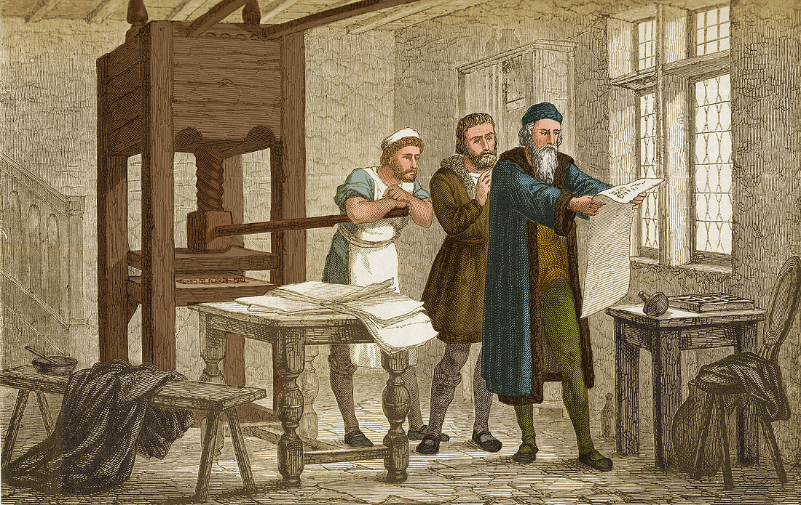

<Intro>
  Slides shown one (or a few) at a time: drag them, click the arrows, or focus the carousel and use the arrow keys.
</Intro>

## Usage

```md
<Carousel>
  <CarouselContent>
    <CarouselItem>
      <div className="flex aspect-video items-center justify-center rounded-2xl border bg-surface-container text-3xl font-bold">React</div>
    </CarouselItem>
    <CarouselItem>
      <div className="flex aspect-video items-center justify-center rounded-2xl border bg-surface-container text-3xl font-bold">Vue</div>
    </CarouselItem>
    <CarouselItem>
      <div className="flex aspect-video items-center justify-center rounded-2xl border bg-surface-container text-3xl font-bold">Svelte</div>
    </CarouselItem>
  </CarouselContent>
  <CarouselPrevious />
  <CarouselNext />
</Carousel>
```

result:

<Carousel>
  <CarouselContent>
    <CarouselItem>
      <div className="flex aspect-video items-center justify-center rounded-2xl border bg-surface-container text-3xl font-bold">React</div>
    </CarouselItem>
    <CarouselItem>
      <div className="flex aspect-video items-center justify-center rounded-2xl border bg-surface-container text-3xl font-bold">Vue</div>
    </CarouselItem>
    <CarouselItem>
      <div className="flex aspect-video items-center justify-center rounded-2xl border bg-surface-container text-3xl font-bold">Svelte</div>
    </CarouselItem>
  </CarouselContent>
  <CarouselPrevious />
  <CarouselNext />
</Carousel>

Same API as [shadcn `Carousel`](https://ui.shadcn.com/docs/components/base/carousel), built on [Embla](https://www.embla-carousel.com/). The arrows sit inside the article's width, in a gutter the carousel keeps on each side.

Markdown inside a `CarouselItem` (an image, a paragraph, a code block) needs a blank line after the opening tag and before the closing one.

## Options

`opts` takes [Embla's options](https://www.embla-carousel.com/api/options/): `loop` to go from the last slide back to the first, `align` to align the slides to the start of the strip rather than its center…

```md
<Carousel opts={{ loop: true }}>
  ...
</Carousel>
```

Plain data only: the page is rendered on the server and the carousel runs in the browser, so `plugins` and `setApi` are not available from MDX.

## Several slides at once

A `basis-*` class on each `CarouselItem` sets how many slides fit at once, with `align: 'start'` so the strip starts on a slide:

```md
<Carousel opts={{ align: "start" }}>
  <CarouselContent>
    <CarouselItem className="basis-1/2 md:basis-1/3">
      <div className="flex aspect-square items-center justify-center rounded-2xl border bg-surface-container text-3xl font-bold">1</div>
    </CarouselItem>
    <CarouselItem className="basis-1/2 md:basis-1/3">
      <div className="flex aspect-square items-center justify-center rounded-2xl border bg-surface-container text-3xl font-bold">2</div>
    </CarouselItem>
    <CarouselItem className="basis-1/2 md:basis-1/3">
      <div className="flex aspect-square items-center justify-center rounded-2xl border bg-surface-container text-3xl font-bold">3</div>
    </CarouselItem>
    <CarouselItem className="basis-1/2 md:basis-1/3">
      <div className="flex aspect-square items-center justify-center rounded-2xl border bg-surface-container text-3xl font-bold">4</div>
    </CarouselItem>
    <CarouselItem className="basis-1/2 md:basis-1/3">
      <div className="flex aspect-square items-center justify-center rounded-2xl border bg-surface-container text-3xl font-bold">5</div>
    </CarouselItem>
  </CarouselContent>
  <CarouselPrevious />
  <CarouselNext />
</Carousel>
```

result:

<Carousel opts={{ align: "start" }}>
  <CarouselContent>
    <CarouselItem className="basis-1/2 md:basis-1/3">
      <div className="flex aspect-square items-center justify-center rounded-2xl border bg-surface-container text-3xl font-bold">1</div>
    </CarouselItem>
    <CarouselItem className="basis-1/2 md:basis-1/3">
      <div className="flex aspect-square items-center justify-center rounded-2xl border bg-surface-container text-3xl font-bold">2</div>
    </CarouselItem>
    <CarouselItem className="basis-1/2 md:basis-1/3">
      <div className="flex aspect-square items-center justify-center rounded-2xl border bg-surface-container text-3xl font-bold">3</div>
    </CarouselItem>
    <CarouselItem className="basis-1/2 md:basis-1/3">
      <div className="flex aspect-square items-center justify-center rounded-2xl border bg-surface-container text-3xl font-bold">4</div>
    </CarouselItem>
    <CarouselItem className="basis-1/2 md:basis-1/3">
      <div className="flex aspect-square items-center justify-center rounded-2xl border bg-surface-container text-3xl font-bold">5</div>
    </CarouselItem>
  </CarouselContent>
  <CarouselPrevious />
  <CarouselNext />
</Carousel>

## Images

Slides hold any markup, images included:

```md
<Carousel>
  <CarouselContent>
    <CarouselItem>
      
    </CarouselItem>
    <CarouselItem>
      
    </CarouselItem>
  </CarouselContent>
  <CarouselPrevious />
  <CarouselNext />
</Carousel>
```

result:

<Carousel>
  <CarouselContent>
    <CarouselItem>
      
    </CarouselItem>
    <CarouselItem>
      
    </CarouselItem>
  </CarouselContent>
  <CarouselPrevious />
  <CarouselNext />
</Carousel>

In the markdown export of a page, the slides follow one another, without the arrows.
